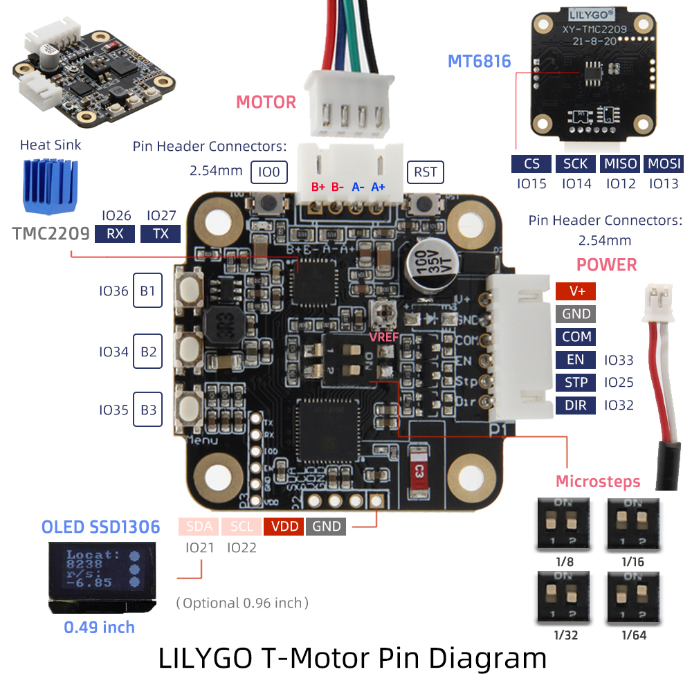
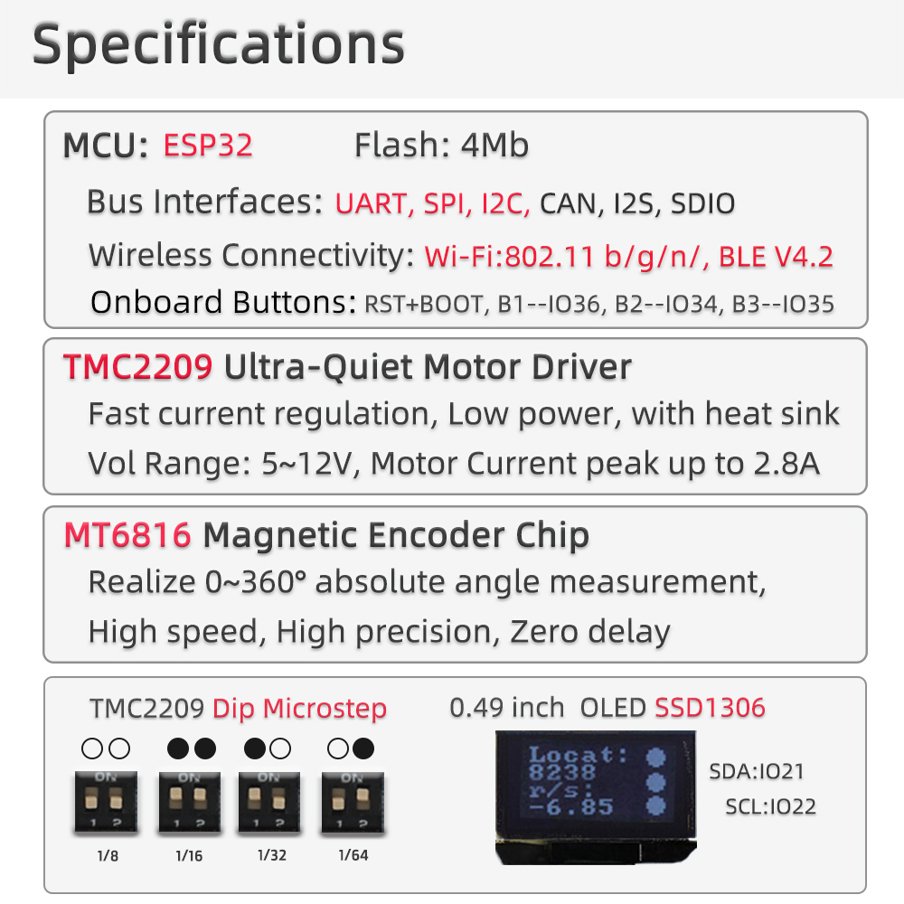

<div align="center" markdown="1">
  
</div>

<h1 align = "center">🌟 T-Motor 🌟</h1>





---

## Table of Contents

- [Table of Contents](#table-of-contents)
- [Product](#product)
- [Quick Start](#quick-start)
  - [PlatformIO Quick Start](#platformio-quick-start)
  - [Arduino IDE Quick Start](#arduino-ide-quick-start)
- [Hardware Description](#hardware-description)
  - [Main Pins Map](#main-pins-map)
  - [TMC2209 UART Address](#tmc2209-uart-address)
  - [TMC2209 UART Wiring](#tmc2209-uart-wiring)
- [Examples](#examples)
  - [TMC2209 Communication Test](#tmc2209-communication-test)
- [Datasheet](#datasheet)
- [Schematic, Case and Images](#schematic-case-and-images)
- [FAQ](#faq)
  - [1. Which board target should I use?](#1-which-board-target-should-i-use)
  - [2. TMC2209 UART scan always returns `VERSION=0x0`. What should I check?](#2-tmc2209-uart-scan-always-returns-version0x0-what-should-i-check)
  - [3. MS1 and MS2 are both high. Which UART address should be used?](#3-ms1-and-ms2-are-both-high-which-uart-address-should-be-used)
  - [4. Upload fails or the serial port is not available.](#4-upload-fails-or-the-serial-port-is-not-available)
- [Dependencies](#dependencies)

---

## Product

T-Motor is an ESP32 based stepper motor driver development board. It integrates a
TMC2209 stepper motor driver and an MT6816 magnetic encoder interface for motor
control and hardware testing.

| Product | MCU | Motor Driver | Encoder Interface | Framework |
| ------- | --- | ------------ | ----------------- | --------- |
| T-Motor | ESP32 | TMC2209 | MT6816 SPI | Arduino / PlatformIO |

> Note: This board uses ESP32. It is not an ESP32-S3 board. Use ESP32/PICO32
> board settings when compiling or uploading firmware.

---

## Quick Start

### PlatformIO Quick Start

1. Install [Visual Studio Code](https://code.visualstudio.com/) and [Python](https://www.python.org/).
2. Install the `PlatformIO` extension in Visual Studio Code.
3. Open this repository folder in Visual Studio Code.
4. Select the example by editing `src_dir` in [platformio.ini](./platformio.ini):

   ```ini
   [platformio]
   src_dir = examples/factory
   ; src_dir = examples/mt6816
   ; src_dir = examples/tmc2209
   ```

5. Build the project with PlatformIO.
6. Connect the board through USB and upload firmware.
7. Open the serial monitor at `115200` baud.

Default PlatformIO settings:

| Setting | Value |
| ------- | ----- |
| Platform | `espressif32@6.12.0` |
| Board | `pico32` |
| Framework | `arduino` |
| Upload Speed | `460800` |
| Monitor Speed | `115200` |
| Partition | `no_ota.csv` |

### Arduino IDE Quick Start

> PlatformIO is recommended because this repository already contains the required
> local libraries.

1. Install [Arduino IDE](https://www.arduino.cc/en/software).
2. Add the ESP32 board manager URL:

   ```txt
   https://raw.githubusercontent.com/espressif/arduino-esp32/gh-pages/package_esp32_index.json
   ```

3. Install the ESP32 board package from Boards Manager.
4. Copy the libraries from [lib](./lib/) to your Arduino libraries directory.
5. Select an ESP32 board target such as `ESP32 Pico Kit` or a compatible ESP32
   development board.
6. Open an example `.ino` file from [examples](./examples/) and upload it.

---

## Hardware Description

### Main Pins Map

| Function | GPIO | Note |
| -------- | ---- | ---- |
| TMC2209 EN | 2 | Enable pin, active low |
| TMC2209 DIR | 18 | Direction input |
| TMC2209 STEP | 23 | Step input |
| TMC2209 CLK | 19 | Clock input, pulled low in examples to use internal clock |
| TMC2209 SPREAD | 4 | Chopper mode selection |
| TMC2209 UART RX | 26 | ESP32 RX, reads TMC2209 `PDN_UART` |
| TMC2209 UART TX | 27 | ESP32 TX, connected through 1 kOhm to `PDN_UART` |
| MT6816 CS | 15 | SPI chip select |
| MT6816 SCLK | 14 | SPI clock |
| MT6816 MISO | 12 | SPI MISO |
| MT6816 MOSI | 13 | SPI MOSI |
| I2C SCL | 21 | OLED / I2C bus |
| I2C SDA | 22 | OLED / I2C bus |
| Button NEXT | 36 | Input only GPIO |
| Button ENTER | 34 | Input only GPIO |
| Button MENU | 35 | Input only GPIO |
| External STEP monitor | 25 | Used by factory example |
| External DIR monitor | 32 | Used by factory example |
| External EN monitor | 33 | Used by factory example |

### TMC2209 UART Address

The TMC2209 UART node address is selected by `MS1_AD0` and `MS2_AD1`.

| MS2 | MS1 | UART Address | Microstep Setting |
| --- | --- | ------------ | ----------------- |
| LOW | LOW | `0b00` | 1/8 |
| LOW | HIGH | `0b01` | 1/32 |
| HIGH | LOW | `0b10` | 1/64 |
| HIGH | HIGH | `0b11` | 1/16 |

The [TMC2209 test example](./examples/tmc2209/tmc2209.ino) scans all four UART
addresses and reports the detected address through the serial monitor.

### TMC2209 UART Wiring

The TMC2209 uses a single-wire UART on `PDN_UART`.

| Signal | Connection |
| ------ | ---------- |
| ESP32 GPIO26 / UART_RX | Connected to TMC2209 `PDN_UART` |
| ESP32 GPIO27 / UART_TX | Connected to TMC2209 `PDN_UART` through 1 kOhm |
| GND | Common ground required |
| VIO / VM | TMC2209 logic and motor power must be present |

When UART communication is healthy, `IOIN.VERSION` should read `0x21`, and
`IFCNT` should increase after successful write access.

---

## Examples

```txt
T-Motor examples
|-- examples/factory   # Factory test: motor, encoder, display, buttons and WiFi
|-- examples/mt6816    # MT6816 SPI magnetic encoder read test
`-- examples/tmc2209   # TMC2209 UART communication link test
```

### TMC2209 Communication Test

The TMC2209 example is intended to verify the UART communication path before
running motor control code.

Expected serial output:

```txt
TMC2209 UART communication test
TMC UART: Serial1 RX=26 TX=27
Address 0b11: IOIN=0x2100014C VERSION=0x21 IFCNT=2->3 FOUND
Result: PASS
```

If all addresses return `VERSION=0x0`, check `PDN_UART`, `UART_RX`, `UART_TX`,
VIO/VM power, common GND, and the MS1/MS2 address level.

---

## Datasheet

- [TMC2209 datasheet](./datasheet/TMC2209_datasheet_rev1.09.pdf)

---

## Schematic, Case and Images

- [T-Motor schematic](./schematic/T-Motor.pdf)
- [Case DXF](./case/T-Motor.DXF)
- [Shell STL](./case/Shell.stl)
- [TMC2209 UART wiring image](./image/tmc2209.png)

---

## FAQ

### 1. Which board target should I use?

Use an ESP32 target. The PlatformIO configuration uses `board = pico32`. Do not
use ESP32-S3 board settings for this board.

### 2. TMC2209 UART scan always returns `VERSION=0x0`. What should I check?

Check that `PDN_UART` is connected to both ESP32 `GPIO26` and `GPIO27`, with
`GPIO27` connected through the 1 kOhm TX resistor. Also check VIO/VM(JST 6Pin V+ and GND) power,
common GND, and the MS1/MS2 address setting.

### 3. MS1 and MS2 are both high. Which UART address should be used?

Use address `0b11`. The TMC2209 example scans all addresses automatically and
should report `Address 0b11 ... FOUND` when the link is working.

### 4. Upload fails or the serial port is not available.

Check the USB cable and selected serial port. If automatic upload fails, hold the
BOOT button, press RESET, release RESET, then release BOOT and upload again.

---

## Dependencies

| Library | Purpose |
| ------- | ------- |
| [TMCStepper](./lib/TMCStepper/) | TMC2209 UART configuration and diagnostics |
| [AccelStepper](./lib/AccelStepper/) | Stepper motion control |
| [U8g2](./lib/U8g2/) | OLED display |
| [OneButton](./lib/OneButton/) | Button handling |
