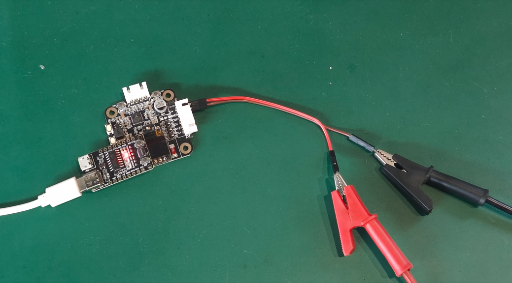

# Test wiring method



# Log

```bash
ets Jun  8 2016 00:22:57

rst:0x1 (POWERON_RESET),boot:0x13 (SPI_FAST_FLASH_BOOT)
configsip: 188777542, SPIWP:0xee
clk_drv:0x00,q_drv:0x00,d_drv:0x00,cs0_drv:0x00,hd_drv:0x00,wp_drv:0x00
mode:DIO, clock div:2
load:0x3fff0030,len:1184
load:0x40078000,len:13232
load:0x40080400,len:3028
entry 0x400805e4

TMC2209 UART communication test
USB Serial: 115200
TMC UART: Serial1 RX=26 TX=27

Scanning TMC2209 UART address...
Datasheet: address bit0=MS1_AD0, bit1=MS2_AD1. MS1=HIGH and MS2=HIGH means address 0b11.
UART_RX idle level before scan: HIGH
Address 0b00: IOIN=0x0 VERSION=0x0 IFCNT=0->0
Address 0b01: IOIN=0x0 VERSION=0x0 IFCNT=0->0
Address 0b10: IOIN=0x0 VERSION=0x0 IFCNT=0->0
Address 0b11: IOIN=0x2100014C VERSION=0x21 IFCNT=2->3 FOUND
Active address: 0b11

TMC2209 UART test #1
Address: 0b11
IOIN: 0x2100014C
VERSION: 0x21 OK (expected 0x21)
IFCNT: 3 -> 7 OK
Pins ENN/MS1/MS2/PDN_UART/STEP/SPREAD/DIR: 0/1/1/1/0/1/0
Result: PASS
Summary pass/fail: 1/0

TMC2209 UART test #2
Address: 0b11
IOIN: 0x2100014C
VERSION: 0x21 OK (expected 0x21)
IFCNT: 7 -> 11 OK
Pins ENN/MS1/MS2/PDN_UART/STEP/SPREAD/DIR: 0/1/1/1/0/1/0
Result: PASS
Summary pass/fail: 2/0

TMC2209 UART test #3
Address: 0b11
IOIN: 0x2100014C
VERSION: 0x21 OK (expected 0x21)
IFCNT: 11 -> 15 OK
Pins ENN/MS1/MS2/PDN_UART/STEP/SPREAD/DIR: 0/1/1/1/0/1/0
Result: PASS
Summary pass/fail: 3/0

TMC2209 UART test #4
Address: 0b11
IOIN: 0x2100014C
VERSION: 0x21 OK (expected 0x21)
IFCNT: 15 -> 19 OK
Pins ENN/MS1/MS2/PDN_UART/STEP/SPREAD/DIR: 0/1/1/1/0/1/0
Result: PASS
Summary pass/fail: 4/0

```